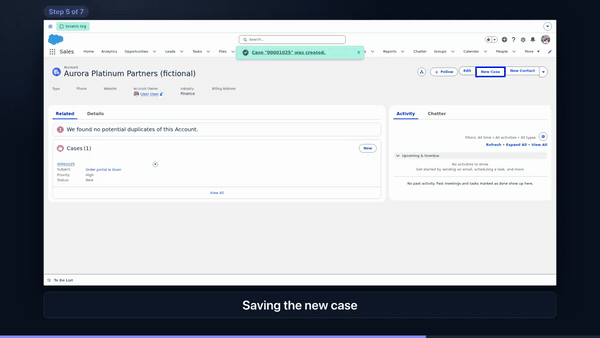
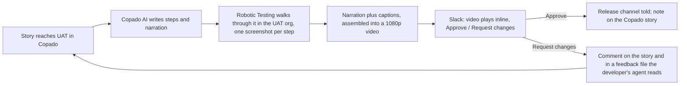
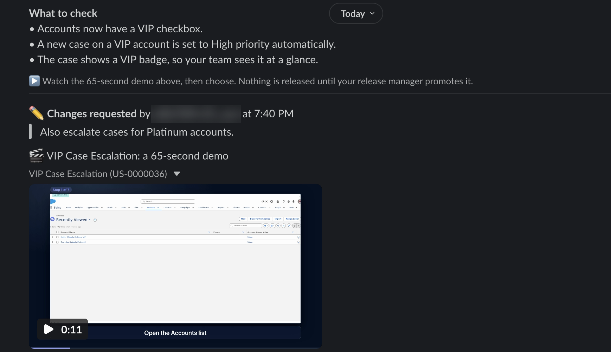

# Agentia Showtime

**Every feature demos itself.** When a user story reaches UAT in Copado, a robot walks through it in the UAT org, Copado AI writes the narration, and the business owner gets a one-minute demo video in Slack with **Approve** and **Request changes** buttons. Their decision lands back on the Copado story.

> **What it is not:** not an alerting tool, and not a chat front-end for the CLI. Showtime closes the *business sign-off* loop: a feature video the pipeline makes by itself, a human decision, and that decision flowing back into Copado.



*A 67-second narrated demo, made with no human in the loop: [`examples/demo/sample.mp4`](examples/demo/sample.mp4).*

## The problem

UAT sign-off is where Salesforce releases stall. Business owners don't log into sandboxes, don't read user stories and don't know what to test, so stories wait days for "looks good."

## What it does



Measured in the recorded demo run: `watch` saw the round-two story in UAT and had **the video in Slack 79 seconds later, with nobody touching it**. The owner approved it about five minutes after that. (`agentia showtime status <story>` prints this timeline.)

| | |
|---|---|
|  | The owner's card after **Request changes**: the comment is quoted, and it is also written to the Copado story and to `.showtime/feedback/<story>.md`. *(An earlier round, before the video's zoom was removed; the reviewer's name is blurred.)* |

## Try it in five minutes, offline

No Copado, Slack, Salesforce org or Mac needed, only Node 20+ and a network connection for the first install:

```bash
git clone https://github.com/gitanjalivanshiv/agentia-showtime.git && cd agentia-showtime
examples/demo/try-offline.sh
```

It builds the plugin, renders a real narrated video from bundled screenshots of the sample app (macOS voice on a Mac, silent narration elsewhere; captions are burned in either way), and prints the exact Slack message Showtime would post. Nothing is sent anywhere.

## Run it for real

Prerequisites: the Agentia CLI (tested with `@copado/agentia-cli` 1.0.0-beta.2) with CICD, CRT and AI auth, the Salesforce CLI authorized for your UAT org (`sf org login web --alias showtime-uat …`), Node 20+, and a Slack workspace.

```bash
npm ci && npm run build
agentia plugins link .          # adds `agentia showtime …`
agentia showtime init           # config, CRT job detection, installs the Agent Skill
agentia showtime doctor         # plain-English fixes for anything missing
# Slack: follow docs/slack-setup.md (about 5 minutes), put two tokens in .env
agentia showtime serve          # the Review Hub: leave it running
agentia showtime run US-0000123 # script → record → render → send
# or let it find stories itself:
agentia showtime watch
```

## Commands

| Command | What it does |
|---|---|
| `showtime init` / `doctor` | Create the config, check every dependency (Copado, CRT, UAT login, ffmpeg, voice, Slack) with fixes |
| `showtime script <story>` | Copado AI writes steps and one narration line each; validated against a schema, with a hand-written fallback |
| `showtime record <story>` | Waits until the story's promotion into UAT has finished deploying, then a Robotic Testing run in UAT, one clean screenshot per step |
| `showtime render <story>` | Narration, cards and captions assembled by ffmpeg; deterministic |
| `showtime send <story>` | Video plus review card to the business owner in Slack (`--dry-run` prints it) |
| `showtime run <story>` | The four stages above, one progress line each |
| `showtime watch` | Polls Copado; runs a show when a `Showtime Demo –` story reaches UAT or returns after changes |
| `showtime serve` | The Review Hub (Slack Socket Mode, no public URL): decisions, release notice, Copado write-back |
| `showtime status [story]` | Lifecycle with times, decision, whether Copado has the note |
| `showtime install-skill` | Installs the Agent Skill into a project |
| `showtime mcp` | Showtime's own MCP server |

All commands accept `--json`.

## Built on Agentia

Showtime is an **Agentia CLI plugin** that uses only the public `agentia` binary with `--json` (never Agentia internals), through one adapter ([`src/agentia/client.ts`](src/agentia/client.ts)):

| Agentia capability | Used for |
|---|---|
| `agentia cicd work list / get / update` | Detecting stories that reached UAT; reading them; writing the review note onto the story |
| `agentia cicd promotion list` | Waiting until the promotion into UAT has finished deploying before recording |
| `agentia testing job upload / build run / project` | Running the generated Robot Framework suite in UAT and collecting screenshots |
| `agentia ai agent ask` | Writing the demo steps and narration from the story |
| `agentia auth get` | Readiness gates (`doctor`) |
| **Agent Skill** ([`skills/showtime`](skills/showtime/SKILL.md)) | Teaches a coding agent to send a demo after a UAT promotion, read the business feedback, and **never** approve or promote itself |
| **MCP server** (`agentia showtime mcp`) | `showtime_status`, `showtime_feedback`, `showtime_script_preview`, `showtime_run` (plan first, `confirm: true` to apply) |

We tested the skill with real agent runs. The skill alone was not enough (the agent answered from the project's own Copado workflow notes); adding a short managed note to `CLAUDE.md` / `AGENTS.md`, the way Agentia names its own skills, fixed it. Details in [`docs/decisions.md`](docs/decisions.md) (D19).

## Principles

- **The human decides.** Showtime never promotes or deploys. Approval records a decision and tells the release manager; promotion is theirs. There is no MCP tool, command or code path for it.
- **Local record first.** A decision is saved on disk before Slack or Copado are touched, so a Copado hiccup (for example another tool holding the shared lock) never loses it.
- **No credentials in the tool.** Slack tokens live in `.env`; the UAT login is a one-time link from the Salesforce CLI, passed to the robot as a run variable and never saved.
- **Deterministic video.** Same inputs, same bytes; a render hash lets an unchanged story reuse its video.
- **Honest limits.** The AI script is only as good as the labels it is told (`--hint`); every run creates one demo Case in the UAT org (`examples/demo/reset.sh` removes them).

## The sample app

[`examples/demo`](examples/demo) is an invented "VIP Case Escalation" app with fictional data: a VIP checkbox and a Tier (Standard / Platinum) on Account, a record-triggered flow that sets High priority, a badge on Case, layouts and a permission set. `seed.sh` deploys it through Copado (asking before every write), `reset.sh` clears the demo Cases. [`examples/demo/urgent`](examples/demo/urgent) is a second, smaller feature ("Urgent case escalation") used for the live two-round demo, with its round-2 fix as a patch; [`docs/demo-runbook.md`](docs/demo-runbook.md) is the on-camera sequence and `examples/demo/preflight.sh` checks the stage is set.

## Repository

```
src/            plugin: commands, pipeline, review hub, MCP server
skills/         the Showtime Agent Skill
docs/           architecture, Agentia commands used, decisions (with the mistakes), Slack setup
examples/demo/  sample app, seed / reset / try-offline scripts, sample screenshots and video
test/           116 tests: schemas, state machine, Block Kit snapshots, ffmpeg commands, fake Copado and Slack
```

`npm test` runs everything with fakes; CI also runs the offline demo. Licence: MIT. Third-party components: [NOTICE.md](NOTICE.md).
